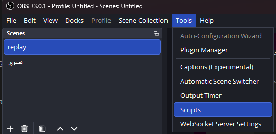
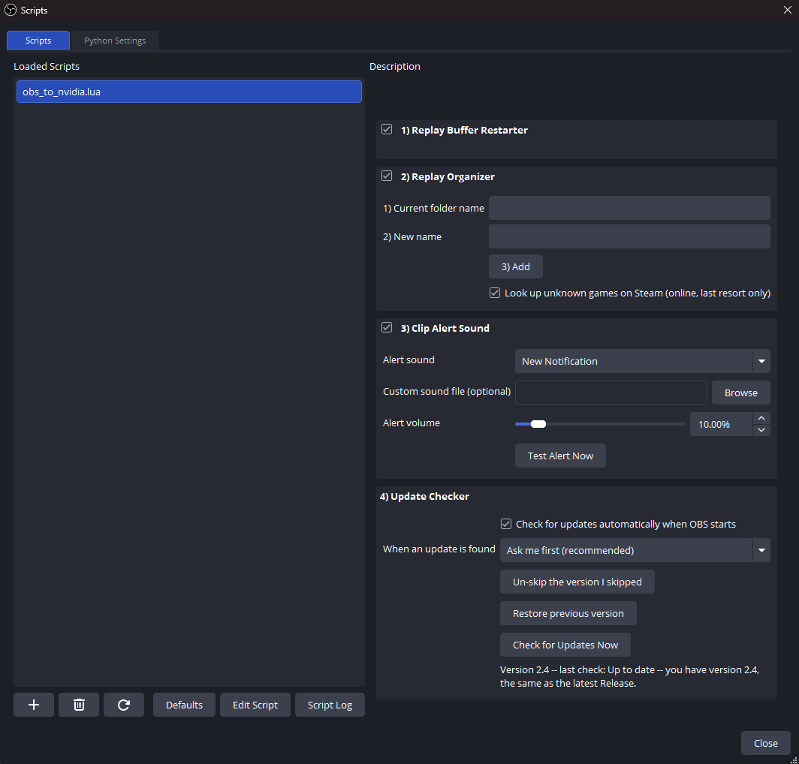

# OBS Clip Suite

One OBS Studio Lua script that makes **Replay Buffer clipping** painless on Windows:

1. **Replay Buffer Restarter** – restarts the buffer right after every save, so back-to-back clips never share overlapping footage.
2. **Replay Organizer** – sorts each saved clip into a per-game / per-app folder automatically.
3. **Clip Alert Sound** – plays a short sound every time a clip is saved.
4. **Update Checker** – checks this repo's Releases and updates the script for you.

Everything lives in a single file: `obs_to_nvidia.lua`.

---

## Requirements

- **Windows** (the Organizer and the updater use Win32 calls; without them the Restarter and Alert modules still work, the Organizer disables itself).
- **OBS Studio** with Lua scripting (the stock Windows build; developed on OBS 33).
- The **Replay Buffer** enabled in OBS (`Settings > Output > Replay Buffer`) and a save hotkey set.

## Install

1. Download `obs_to_nvidia.lua` from the [latest Release](../../releases/latest).
2. Put it somewhere permanent (OBS remembers the path; don't leave it in Downloads).
3. In OBS: **Tools > Scripts > `+`** and pick the file.

That's it. Each module has its own group in the Scripts window with an on/off checkbox in the group header.

## What each module does

On every `Replay Buffer Saved` event the modules run in this order:

1. The Alert plays its sound (first, so it is never delayed by the Organizer). It only plays for a real save: the `Saved` event plus the clip file being on disk.
2. The Organizer moves the clip into its folder.
3. The Restarter stops and restarts the Replay Buffer.

An error in one module never stops the others.

### 1) Replay Buffer Restarter

After a save, the script asks OBS to stop the buffer, waits for OBS's "stopped" event, starts it **once**, and waits for the "started" event. A slow watchdog timer is only a safety net in case an event never arrives (it retries a few times, then logs a warning instead of looping forever).

### 2) Replay Organizer

Sorts every saved clip into a subfolder named after the game or app you were actually playing.

- Detects the **real foreground window** using direct Win32 calls only (no `cmd.exe` / PowerShell is spawned), so **fullscreen games are never minimized or kicked to the desktop**.
- Keeps a short rolling history of the foreground app, so a save that fires a couple of seconds after you alt-tab still goes to the right game.
- Non-game apps go into a shared **Desktop** folder.
- Never overwrites an existing clip if two clips get the same name in the same second.
- Handles non-ASCII (e.g. Arabic) folder names and paths.
- **Custom names:** in the group, type the current folder name, type the new name, press **Add**. Your entries are saved with the script's settings.
- **Known games list:** a built-in list is merged with your own entries in `known_games.txt` (in `%APPDATA%\obs-studio\script-data\OBS-Clip-Suite`). Reload the script after editing it.
- **Game names:** your own names > built-in/known_games.txt > the game's window title > the Steam install folder name (offline) > Steam lookup.
- **Steam lookup (optional):** only when a game has no window title and no Steam folder, unknown games can be looked up on the Steam Store by name. Results are remembered in `known_games.txt`. Turn it off with *Look up unknown games on Steam*.

### 3) Clip Alert Sound

Off by default. Turn it on with the group's checkbox, then choose:

- one of **6 built-in sounds** (embedded in the script, no extra files),
- or your own file (`.wav .mp3 .ogg .aac .flac`) under *Custom sound file*,
- the **volume** (0–100 %),
- and press **Test Alert Now** to hear it.

### 4) Update Checker

- Checks GitHub Releases ~10 seconds after OBS starts (can be turned off), or any time with **Check for Updates Now**.
- Updates are compared by **version number** (`1.10.0` is newer than `1.9.0`); only a *higher* version is offered.
- **When an update is found**:
  - *Ask me first* (default) – a dialog: Yes = install, No = skip this version, Cancel = ask again later.
  - *Install it automatically* – installs when no stream / recording / virtual camera is active and no fullscreen game is in front (the Replay Buffer doesn't block it: it is stopped first and started again by the new OBS).
  - *Only mention it in the log*.
- The dialog and installs are held back while a fullscreen game is in the foreground. The dialog is also held back while a stream / recording / virtual camera is active, and only one dialog can be open at a time.
- An update restarts OBS twice (it opens and closes twice): the second restart is what loads the new version. The Replay Buffer is resumed at the end.
- **Restore previous version** puts the newer version on the skipped list, so it isn't offered again right after the restore.
- Your old script is backed up next to it as `obs_to_nvidia.lua.bak` and `obs_to_nvidia.lua.bak-<version>`. **Restore previous version** brings it back.
- **How an update is applied (2.4.2+):** the new file is written next to the script as `obs_to_nvidia.lua.staged`. OBS then starts a fresh instance, the old one closes, and the *new* instance swaps the file in and starts the Replay Buffer again – once. The running script file is never overwritten while OBS is using it.

## Settings files created next to the script

| File | Purpose |
| --- | --- |
| `obs_to_nvidia.lua.bak`, `.bak-<version>` | Backups made by the updater |
| `obs_to_nvidia.lua.staged` | Downloaded update waiting to be applied (temporary) |
| `obs_to_nvidia_update_state.tmp` | Temporary marker used during a self-update |
| `known_games.txt` (in `%APPDATA%\obs-studio\script-data\OBS-Clip-Suite`) | Your extra game names and cached Steam results |

## Troubleshooting

- **"No properties available" / `Error opening file: (null)` in the Script Log** – OBS couldn't read the script file. Check that `obs_to_nvidia.lua` exists at the path shown in Tools > Scripts, remove the entry, and add the file again.
